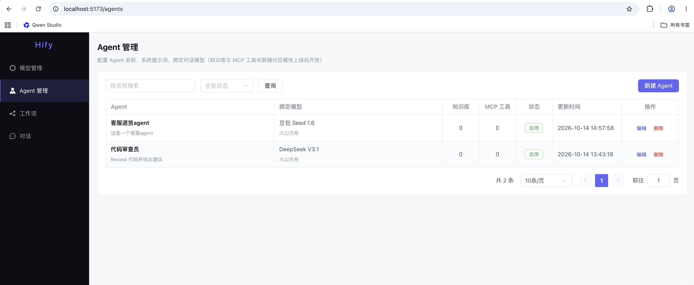

# Hify

简化版内部 AI Agent 平台（参考 Dify 思路设计）：模型接入 → Agent 配置 → 多轮对话（SSE 流式）→ 简版工作流编排。

**定位**：企业内部小团队使用（20–50 人），本地/内网部署。没有登录鉴权体系，请部署在可信网络边界内。

## 功能

| 模块 | 状态 | 说明 |
|------|------|------|
| 模型管理 | ✅ | OpenAI / OpenAI 兼容（火山方舟等）/ Ollama 提供商配置，连通性测试，密钥出参脱敏 |
| Agent 配置 | ✅ | 系统提示词、绑定模型、绑定工作流，知识库/MCP 关联预留 |
| 对话引擎 | ✅ | 多轮对话、游标分页历史、SSE 流式响应、Agent 绑工作流时走编排分支 |
| 工作流 | ✅ | 开始 → LLM → 条件分支 → 结束，图校验（无环/可达性/分支完整性），试运行与执行记录 |
| 知识库 RAG | 🚧 空壳 | 规划：文档上传 → 异步向量化 → pgvector 检索 → 注入上下文 |
| MCP 工具 | 🚧 空壳 | 规划：接入外部 MCP 工具供 Agent/工作流调用 |

## 技术栈

- 后端：Spring Boot 3.5 / JDK 21 / MyBatis-Plus / MySQL 8（+ Redis、pgvector 预留）
- 前端：Vue 3 + TypeScript + Vite + Element Plus
- 架构：Maven 多模块的模块化单体，模块间只经 `api/` 包互调，可平滑拆微服务
- 可观测：结构化日志（prod profile 输出 JSON）、OpenTelemetry traceId 跨线程池串联、Grafana Dashboard（`deploy/grafana/`）

## 快速开始（本地开发）

前置：JDK 21、Maven、Node 20+、MySQL 8。

```bash
# 1. 建库建账号（密码为本地开发默认值，可用 HIFY_MYSQL_PASSWORD 覆盖）
mysql -uroot -p -e "CREATE DATABASE hify CHARACTER SET utf8mb4 COLLATE utf8mb4_unicode_ci;
  CREATE USER 'hify'@'127.0.0.1' IDENTIFIED BY 'hify123';
  GRANT ALL PRIVILEGES ON hify.* TO 'hify'@'127.0.0.1';"

# 2. 初始化表结构
for f in hify-*/src/main/resources/db/schema.sql; do mysql -h127.0.0.1 -uhify -phify123 hify < "$f"; done

# 3. 后端（8080）
mvn -pl hify-bootstrap spring-boot:run

# 4. 前端（5173，代理 /api 到 8080）
cd hify-web && npm ci && npm run dev
```

## 打包部署

```bash
make package        # 产出 target/hify-<version>.tar.gz：jar + 前端 dist + start/stop 脚本 + 配置模板
```

目标机器只需 JDK 21+ 和外部 MySQL；连接信息用环境变量或 `conf/hify.env` 注入。详见 [deploy/local/README-DEPLOY.md](deploy/local/README-DEPLOY.md)。

## 仓库结构

```
hify-common/        通用：异常、Result、线程池（trace 透传）、日志配置
hify-model/         LLM 提供商与模型配置、流式/非流式客户端
hify-agent/         Agent 配置与跨模块绑定校验
hify-conversation/  对话引擎（SSE、会话/消息、上下文）
hify-workflow/      工作流定义、图校验、执行引擎
hify-knowledge/     知识库（空壳）
hify-mcp/           MCP 工具（空壳）
hify-bootstrap/     启动模块（装配全部模块、托管前端静态资源）
hify-web/           Vue 前端
deploy/             本地部署包模板、Grafana Dashboard
docs/               接口文档与迭代 backlog
```

## 测试

```bash
mvn test                      # 单元测试（130+，纯 Mockito，不依赖外部环境）
mvn test -Pintegration        # 集成测试（需本机 MySQL 与 hify_test schema，LLM 用 MockWebServer）
```

## 文档

- 开发规范、核心链路与风险地图：[CLAUDE.md](CLAUDE.md)
- 接口文档：[docs/api/](docs/api/)

## 系统架构



